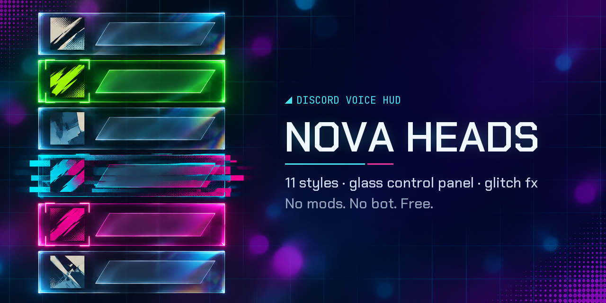
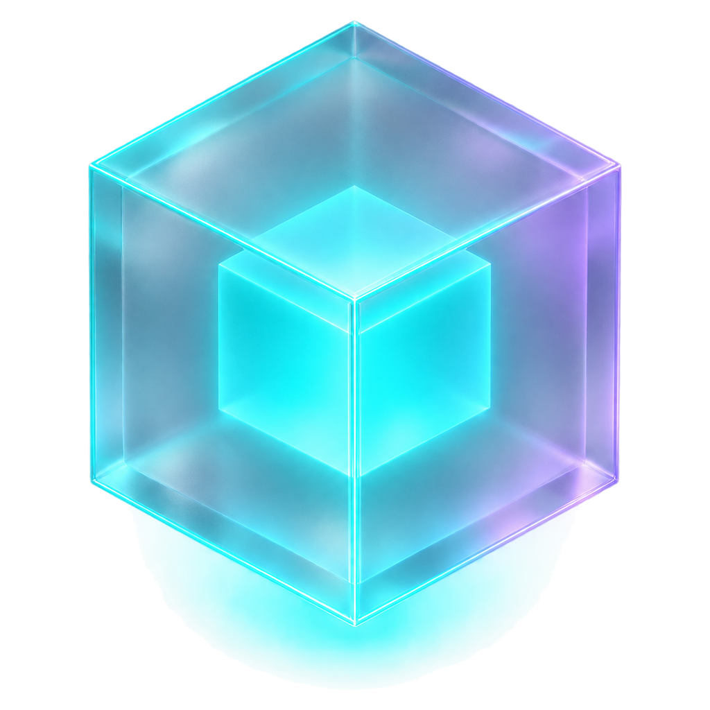
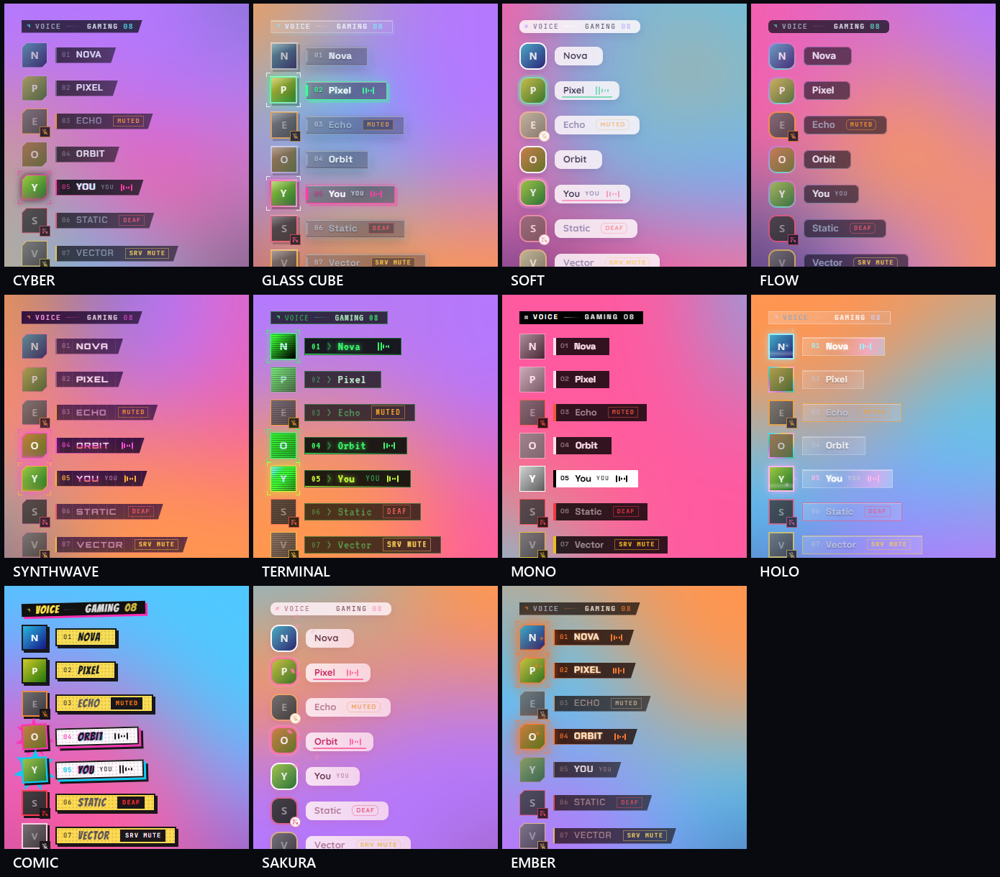
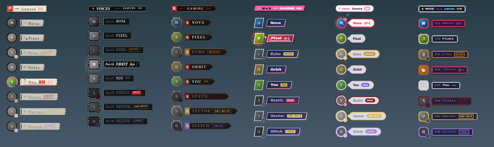
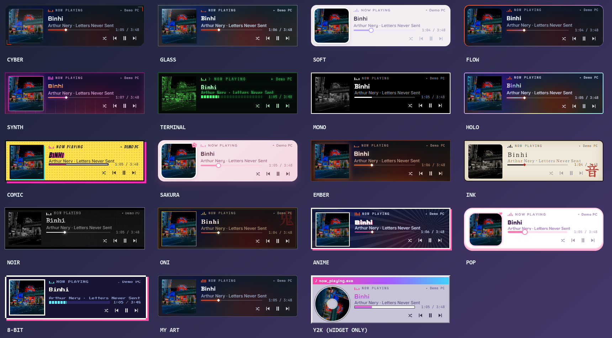
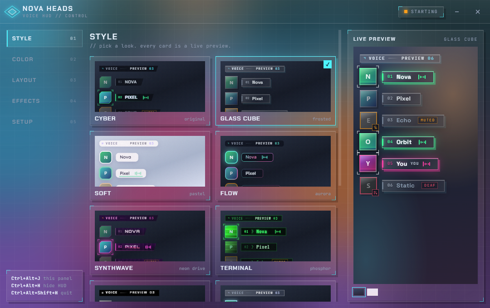
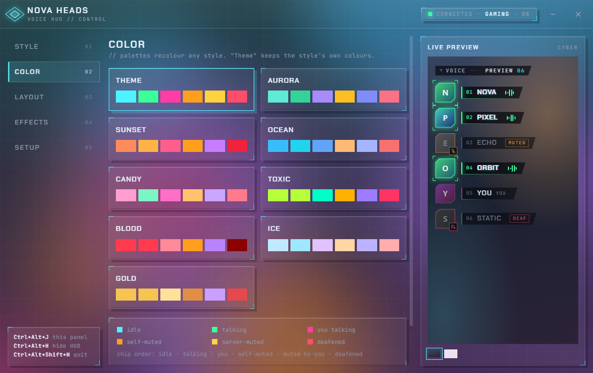

<p align="center"></p>

#  Nova StreamHub

*(formerly Nova Heads)*

**A custom Discord voice overlay for Windows, now with a Spotify now-playing widget.** It shows who's in your voice channel as a HUD on top of your games.
Whoever is talking lights up, and every style has its own join/leave animation and sound effects. There are **17 styles** and **9 colour palettes**,
and a **frosted-glass control panel** where you change them live.

No Discord mods, no bot, no account risk. It reads your voice channel from the Discord app on your PC through Discord's
official local RPC.





## Spotify now playing (new)

A now-playing card that sits next to the voice list: album art, title, artist, progress, with the same pop-in effects
(glitch, brush, slash, film, zoom, pixel...) and sounds as the HUD. It comes in a variant of **every style** plus a Y2K one,
and by default it follows whatever style the HUD is using.



- **Click-through**: like the HUD, it never takes a click while you work or play. Control music from the panel's **MUSIC** page
  (play/pause, skip, shuffle, seek, and a grid of your playlists: click one to play it).
- **Never overlaps the voice list**: move it in **LAYOUT** (switch the map to NOW PLAYING and drag). The two boxes collide;
  when more people join and the list grows, the widget slides out of the way, and comes back when it shrinks.
- Style, pop-in effect, colour (from the album art or your HUD accent), size, opacity, hide when nothing plays, hide from recordings.

**Connect it (one time, free):**
1. Open **[developer.spotify.com/dashboard](https://developer.spotify.com/dashboard)** and log in.
   Spotify needs your account's email to be verified, and since February 2026 the app owner needs **Spotify Premium**.
2. **Create app**: any name, redirect URI `http://127.0.0.1:8888/callback`, tick **Web API**, save.
3. Copy the app's **Client ID** (no secret needed).
4. In the control panel go to **MUSIC**, paste it into **CONNECT SPOTIFY**, click **CONNECT** and agree in the browser tab.

The login is stored in `spotify_token.json` next to the app, on your PC only. Spotify has to be open on some device for play/skip to work.

## Download & run (2 minutes)

1. Go to **[Releases](../../releases/latest)** and download **`NovaHeads-win-x64.zip`**.
2. Extract it anywhere (for example `Documents\NovaHeads`).
3. Double-click **`Start Nova Heads.bat`**.
4. The first time, Discord shows an **Authorize** box. Click **Authorize**.
5. The control panel opens. Pick a style, and you're done.

> Discord desktop must be open. Run your games in **borderless / windowed** mode, because exclusive fullscreen hides every overlay.
> If you also use Discord's own overlay, turn off its **Voice** widget (Settings → Game Overlay) so you don't see two lists.

## Controls

| Key | Does |
|---|---|
| `Ctrl+Alt+J` | open the control panel (also: click the tray icon) |
| `Ctrl+Alt+H` | show / hide the HUD |
| `Ctrl+Alt+M` | show / hide the now-playing widget |
| `Ctrl+Alt+Shift+H` | quit |
| `Ctrl+Alt+←` / `→` | switch style mid-game |

## The control panel



- **Style**: Cyber, Glass Cube, Soft, Flow, Synthwave, Terminal, Mono, Holo, Comic, Sakura, Ember, plus the art styles
  Ink 墨 (calligraphy), Noir (b&w film), Oni 鬼 (samurai), Anime (manga panel), Pop (cutesy stickers) and 8-Bit. Every card is a live preview.
  **My Art** builds a style from your own avatar-frame and name-plate images.
- **Color**: palettes that recolour any style (Aurora, Sunset, Ocean, Candy, Toxic, Blood, Ice, Gold) plus an accent override.
- **Layout**: size, idle opacity, **compact mode** (avatars in a row, the talker's name pops up), header/names, only who's talking, hide yourself.
- **Layout**: pick **which monitor** the HUD is on from a map of your screens (IDENTIFY flashes each screen's number),
  then drag the HUD box anywhere or use the 9-spot grid. Heads hug the nearest edge and the list grows upward near the bottom.
- **Effects**: join/leave animation (each style's own signature: glitch, brush stroke, katana slash, film flicker, sticker pop,
  8-bit pop + pixel burst... or soft / none), synthesized **sound effects** per style with a volume slider, particles, and **real glass blur**.
- **People**: give anyone their own talk colour, nickname or head image, or hide them. Saved by username.
- **Games**: save a look (style, colours, screen, position, size) for a game; the HUD switches to it by itself while that game runs.
- **Stream**: an **OBS browser source** link (this PC only) with a transparent background, plus "hide my overlay from capture" so it never shows twice.
  Add `?theme=oni`, `?palette=gold` or `?scale=1.4` to the link for a stream-only look.
- **Stats**: who talked the most this session.
- **Setup**: start with Windows, custom heads folder.
- Also: "Nova JOINED / LEFT" banners in your style's look, and a glow that warms up the longer someone keeps talking.



### Status colours

| | default colour |
|---|---|
| talking | green |
| you talking | pink |
| muted (self) | orange |
| server-muted | gold |
| muted by you | violet |
| deafened | red |

### Custom heads

Put a picture in the `heads` folder named after someone's Discord **username**:

```
heads\coolfriend.png        replaces their avatar
heads\coolfriend_talk.png   optional, shown while they talk (PNGtuber style)
```

PNG, GIF, WebP and JPG all work. Animated GIF/WebP play too.

### Real glass blur

When it's on, the plates show your actual game blurred through them. Windows only allows this if the overlay hides itself from screen
capture, so **the HUD won't appear in recordings or screenshots (NVIDIA, OBS, Snipping Tool) while this is on.** It's off by default.

## Run from source

Needs [Node.js](https://nodejs.org) 20+.

```bash
git clone https://github.com/UnoRfl/nova-heads
```

```bash
cd nova-heads
```

```bash
setup.bat
```

`setup.bat` installs Electron and starts the app. After that, `Start Nova Heads.bat` is enough. To see it without Discord, run
`npm run demo` inside `app`.

## How it works

- `app/main.js`: a transparent, click-through, always-on-top window, plus a Discord RPC client over the local named pipe.
  It uses Discord's own **StreamKit** app id, the same approach as [trigg/Discover](https://github.com/trigg/Discover),
  so you don't need to create a developer app. Your token is saved next to the app in `token.json`. **Never share that file.**
- `app/hud.js` + `hud.css` + `themes.css`: the HUD engine and styles, shared by the overlay and the panel previews.
- `app/panel.html`: the control panel, a Windows acrylic window.

**What Discord's local API can't tell an app:** who is streaming (LIVE), soundboard sounds, or how loud people are.
Only a bot sitting in the call could get those.

## Files it creates (next to the app, never uploaded)

`config.json` (your settings), `token.json` (Discord login for RPC), `nova_heads.log`, `heads\`.

## License

MIT for the code. The bundled fonts (Chakra Petch, JetBrains Mono, Space Grotesk, Inter, Quicksand, Orbitron, Bangers, VT323) are from
Google Fonts under the SIL Open Font License 1.1.
